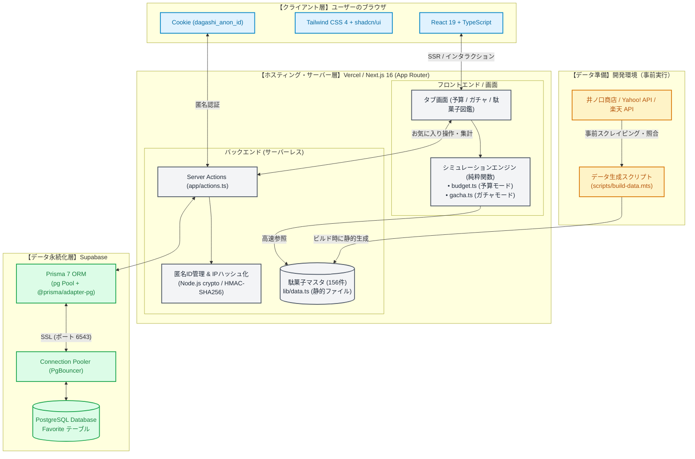

# システムアーキテクチャ・技術構成図

「駄菓子シミュレータ」のシステム全体像、使用技術の相関関係、および設計上の決定事項をまとめたドキュメントです。

---

## 1. 全体アーキテクチャ構成図

---

## 2. レイヤー別の技術スタックと役割

| レイヤー | 採用技術 | 役割と選定理由 |
| :--- | :--- | :--- |
| **フロントエンド** | **Next.js 16.3.3 (App Router)** **React 19.2.8** **TypeScript 5** | 最新の App Router と React 19 を採用。サーバーコンポーネントとクライアントコンポーネントの適切な分離により、初期表示の高速化と対話性を両立。 |
| **UI・スタイル** | **Tailwind CSS 4** **shadcn/ui (Base UI)** **lucide-react** | 最新の Tailwind CSS 4 を使用。軽量かつ一貫性のあるデザインシステムと、レスポンシブな操作体験を提供。 |
| **シミュレーション** | **純粋関数設計** (TypeScript) | 予算・ガチャの抽選処理は DOM や React に依存しない純粋関数として実装。シード付き乱数を用いることでテストの完全な再現性を担保。 |
| **駄菓子データ** | **静的配列（TypeScript）** + データ収集スクリプト | 実在の駄菓子データ（156件）は事前にスクレイピング・API照合して `lib/data.ts` に静的化。**DB問い合わせを不要にし、アクセス集中時も落ちない高可用性を実現**。 |
| **バックエンド** | **Next.js Server Actions** | API エンドポイントを定義することなく、クライアントからサーバー関数を型安全に直接呼び出し。 |
| **セキュリティ** | **Node.js crypto** (HMAC-SHA256) | 登録者の IP アドレスを秘密鍵でハッシュ化して保存。個人情報を秘匿しつつ、同一ネットワークからの水増し登録をブロック。 |
| **データベース** | **Supabase (PostgreSQL)** **Prisma 7** (`@prisma/adapter-pg`) | お気に入り情報のみをリレーショナルDBで永続化。Vercel（サーバーレス）環境に対応するため、PgBouncer 接続プール（ポート 6543）経由で接続。 |
| **ホスティング** | **Vercel** | Git リポジトリと連携した継続的デプロイ（CI/CD）、エッジ配信、サーバーレス実行基盤を提供。 |

---

## 3. 設計上の主要なポイント

### ① 駄菓子マスタデータの静的化（高速性と可用性）
駄菓子データは頻繁に更新されないため、あえてデータベースには格納せず、ビルド済みの静的配列（`lib/data.ts`）として配信しています。
- **メリット**:
  - 何万人のユーザーがアクセスしてもデータベースへの負荷は一切発生しません。
  - ページ読み込み速度（LCP）が極めて高速になります。

### ② ログイン不要のお気に入り ＆ 水増し防止
「駄菓子アプリでログインを求められると誰も使わない」というユーザー体験を考慮し、**ログイン不要（匿名利用）**を採用しています。
- **Cookie（`dagashi_anon_id`）**:
  - 初回アクセス時に UUID を自動発行して `httpOnly` Cookie に保持。個人の「自分のお気に入り一覧」を管理します。
- **IPハッシュ（HMAC-SHA256）**:
  - 水増し対策として、IP アドレスを直接保存するのではなくハッシュ化して保存。
  - 集計時に `COUNT(DISTINCT "ipHash")` を行うことで、同じ端末・シークレットモード等で何度も押されても「1件」として公平に集計します。

### ③ サーバーレスと接続プール（Prisma 7 + Supabase）
Vercel のようなサーバーレス環境では、アクセスごとにインスタンスが立ち上がり DB 接続数が急増するリスクがあります。
- Supabase の **トランザクションモード・コネクションプーラー（PgBouncer / ポート 6543）** を使用。
- Prisma 7 のドライバアダプタ（`@prisma/adapter-pg`）と `pg.Pool` の `max: 2` 設定により、DB 接続数を最小限に抑えて安定稼働を実現しています。

